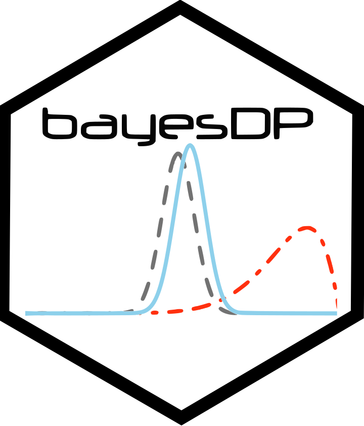

# bayesDP 

`bayesDP` implements the Bayesian discount prior approach for borrowing
historical information in one-arm and two-arm clinical trials. The
package supports binomial, normal, survival, linear-model, and
logistic-regression settings, and provides plotting and summary methods
for inspecting posterior estimates and discount weights.

The method adaptively discounts historical information according to the
agreement between current and historical data. See [Haddad et
al. (2017)](https://www.tandfonline.com/doi/full/10.1080/10543406.2017.1300907)
for methodological details.

## Links

- Package website: <https://graemeleehickey.github.io/bayesDP/>
- Source code: <https://github.com/graemeleehickey/bayesDP>
- CRAN: <https://CRAN.R-project.org/package=bayesDP>
- Issues: <https://github.com/graemeleehickey/bayesDP/issues>

## Installation

Install the released version from CRAN:

``` r

install.packages("bayesDP")
```

Install the development version from GitHub:

``` r

# install.packages("remotes")
remotes::install_github("graemeleehickey/bayesDP")
```

## Supported analyses

| Function | Outcome / model | Typical use |
|----|----|----|
| [`bdpbinomial()`](https://graemeleehickey.github.io/bayesDP/reference/bdpbinomial.md) | Binomial response | Event rates and proportions |
| [`bdpnormal()`](https://graemeleehickey.github.io/bayesDP/reference/bdpnormal.md) | Normal summary statistics | Continuous endpoints with known summaries |
| [`bdpsurvival()`](https://graemeleehickey.github.io/bayesDP/reference/bdpsurvival.md) | Survival response | Time-to-event endpoints |
| [`bdplm()`](https://graemeleehickey.github.io/bayesDP/reference/bdplm.md) | Linear model | Individual-level continuous outcomes |
| [`bdplogit()`](https://graemeleehickey.github.io/bayesDP/reference/bdplogit.md) | Logistic regression | Individual-level binary outcomes |

## Basic examples

### Binomial endpoint

``` r

library(bayesDP)

fit_bin <- bdpbinomial(
  y_t = 10, N_t = 500,
  y0_t = 25, N0_t = 250,
  method = "fixed"
)

summary(fit_bin)
#>
#>     One-armed bdp binomial
#>
#> Current treatment data: 10 and 500
#> Historical treatment data: 25 and 250
#> Stochastic comparison (p_hat) - treatment (current vs. historical data): 0
#> Discount function value (alpha) - treatment: 0
#> 95 percent equal-tailed credible interval:
#>  0.0109  0.0363
#> Posterior medians:
#>  0.0211
```

### Normal endpoint

``` r

fit_norm <- bdpnormal(
  mu_t = 30, sigma_t = 10, N_t = 250,
  mu0_t = 50, sigma0_t = 5, N0_t = 250,
  method = "fixed"
)

summary(fit_norm)
#>
#>     One-armed bdp normal
#>
#> data:
#>   Current treatment: mu_t = 30, sigma_t = 10, N_t = 250
#>   Historical treatment: mu0_t = 50, sigma0_t = 5, N0_t = 250
#> Stochastic comparison (p_hat) - treatment (current vs. historical data): 0
#> Discount function value (alpha) - treatment: 0
#> 95 percent equal-tailed credible interval:
#>  28.7736  31.2335
#> Posterior median:
#> population mean of treatment group
#>  30.0068
```

### Individual-level linear model

``` r

set.seed(2710)
n_t <- 30
n_c <- 30
n_t0 <- 80
n_c0 <- 80

treatment <- c(rep(1, n_t), rep(0, n_c))
treatment0 <- c(rep(1, n_t0), rep(0, n_c0))
x <- rnorm(n_t + n_c, 1, 5)
x0 <- rnorm(n_t0 + n_c0, 1, 5)

Y <- 10 + 31 * treatment + 3 * x + rnorm(n_t + n_c, 0, 5)
Y0 <- 10 + 30 * treatment0 + 3 * x0 + rnorm(n_t0 + n_c0, 0, 5)

df <- data.frame(Y = Y, treatment = treatment, x = x)
df0 <- data.frame(Y = Y0, treatment = treatment0, x = x0)

fit_lm <- bdplm(Y ~ treatment + x, data = df, data0 = df0, method = "fixed")
summary(fit_lm)
#>
#> Call:
#> bdplm(formula = Y ~ treatment + x, data = df, data0 = df0, method = "fixed")
#>
#> Residuals:
#>      Min     1Q Median    3Q    Max
#>  -13.725 -3.519  0.504 4.383 11.851
#>
#> Coefficients:
#>             Estimate Std. Error
#> (Intercept)   9.8228     0.6956
#> treatment    32.3783     1.1265
#> x             3.1145     0.1299
#>
#> Discount function value (alpha):
#>  treatment control
#>       0.07  0.3812
#>
#> Residual standard error: 5.4394
```

## Tabular results

[`tidy()`](https://graemeleehickey.github.io/bayesDP/reference/tidy.md)
returns posterior estimates and SDs, with optional equal-tailed credible
limits.
[`glance()`](https://graemeleehickey.github.io/bayesDP/reference/glance.md)
returns one row containing current and historical sample sizes, retained
draw counts, and discount weights. Both functions also work when called
through broom.

``` r

tidy(fit_bin, conf.int = TRUE, conf.level = 0.95)
glance(fit_bin)
tidy(fit_lm, conf.int = TRUE)
tidy(fit_lm, effects = "sigma", conf.int = TRUE)
```

The conventional `std.error` column contains posterior SDs, and
`conf.low` and `conf.high` contain credible limits. Estimates follow
[`summary()`](https://rdrr.io/r/base/summary.html): posterior medians
for binomial, normal, and one-arm survival results, and posterior means
for regression coefficients and the two-arm log hazard ratio. Binomial
and normal results include treatment-minus-control differences when a
control arm is present.

For logistic and two-arm survival fits, `exponentiate = TRUE` reports
the exponential of the posterior mean log effect and exponentiated
credible limits, with posterior SDs calculated on the ratio scale. For
one-arm survival fits, `time` selects the survival time of interest and
defaults to the fit’s `surv_time`. See
[`?tidy`](https://graemeleehickey.github.io/bayesDP/reference/tidy.md)
and
[`?glance`](https://graemeleehickey.github.io/bayesDP/reference/glance.md)
for definitions and examples. These functions summarise saved draws
without refitting. `augment()` is not currently provided.

With the optional modelsummary package installed, fits can also be
passed directly to comparison tables:

``` r

modelsummary::modelsummary(fit_lm, statistic = "conf.int")
```

The table intervals are posterior credible intervals. Keep the default
`vcov = NULL` and `coef_rename = FALSE`; use `coef_map` to change
displayed coefficient names. Covariance overrides are not supported
because uncertainty is calculated from posterior draws.

## Extracting estimates and draws

Linear and logistic regression fits support the usual R extraction
functions. [`coef()`](https://rdrr.io/r/stats/coef.html) returns
posterior means, [`vcov()`](https://rdrr.io/r/stats/vcov.html) returns
the covariance of the coefficient draws, and
[`confint()`](https://rdrr.io/r/stats/confint.html) returns equal-tailed
credible intervals. These use the original covariate scale, retain
logistic coefficients on the log-odds scale, and exclude the linear
model’s residual SD.

``` r

coef(fit_lm)
vcov(fit_lm)
confint(fit_lm, parm = "treatment", level = 0.9)
nobs(fit_lm)
```

[`nobs()`](https://rdrr.io/r/stats/nobs.html) works for every fitted
model and counts current participants only. Historical participants are
counted separately by
[`glance()`](https://graemeleehickey.github.io/bayesDP/reference/glance.md),
including when they supply the only control group. For survival models,
counts refer to participants rather than split follow-up intervals.

With the optional posterior package installed, all fitted models can be
converted to standard draw formats for further calculations and use with
tidybayes or bayesplot:

``` r

draws <- posterior::as_draws_df(fit_bin)
quantile(draws$treatment, c(0.025, 0.975))
posterior::as_draws_matrix(fit_lm)
```

Binomial and normal conversions include arm outcomes and their paired
difference. Regression conversions include all coefficient draws and,
for linear models, the residual SD `sigma`. Survival conversions include
interval log hazards and the survival probability or approximate common
log hazard ratio reported by
[`tidy()`](https://graemeleehickey.github.io/bayesDP/reference/tidy.md).
See
[`?posterior_draws`](https://graemeleehickey.github.io/bayesDP/reference/posterior_draws.md)
for variable definitions.

Conversion preserves the saved draws and their order, without
resampling. The `.chain = 1` label represents the single stored
sequence; it does not create independent chains or establish
convergence. Discount weights and comparison probabilities remain
available in the fitted object.

## Citation

If you use `bayesDP`, please cite the package and the methodological
paper:

``` r

citation("bayesDP")
```
